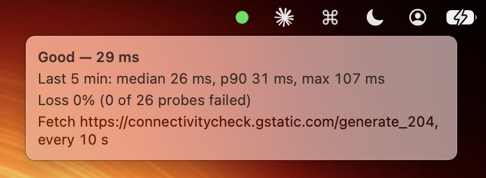
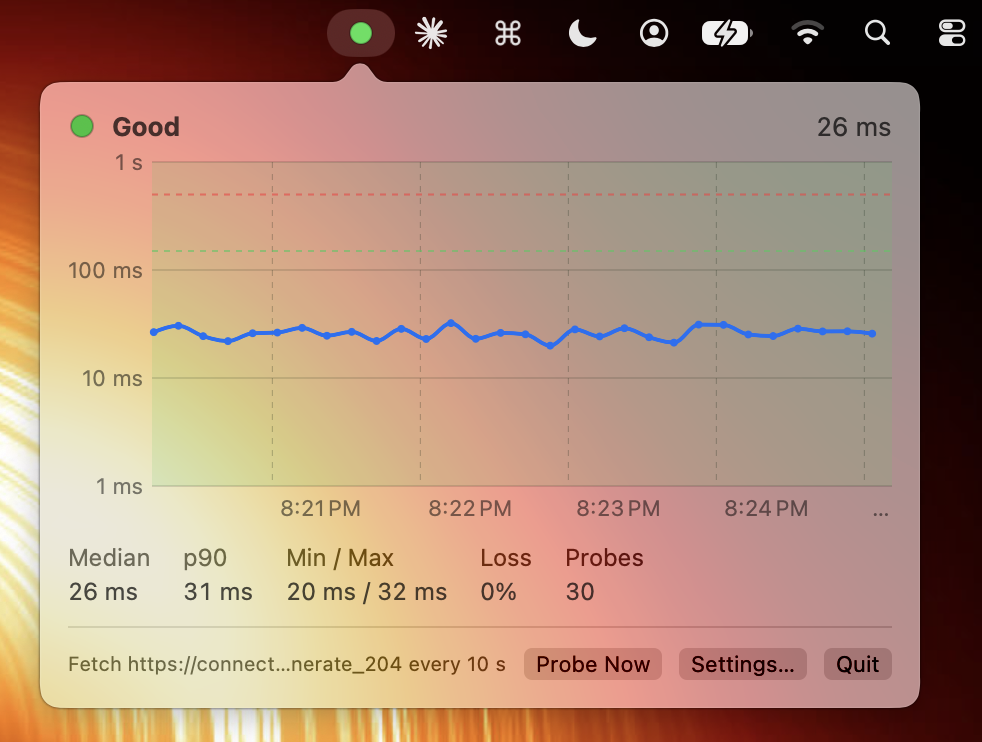

# online-status

Online Status is a macOS menu bar application. It shows the quality of your internet connection.
Use it when the network is not reliable, for example a personal hotspot or Wi-Fi on a train or bus.

A colored dot in the menu bar shows the status of the connection:

| Icon | Meaning |
|---|---|
| 🟢 | Good |
| 🟡 | Mixed |
| 🔴 | Poor |
| ⚫ | No connectivity |
| 🔒 | You must log in to the Wi-Fi network (captive portal) |
| ◯ | Measurement in progress (the application started, or the network changed) |

Put the pointer on the dot to see a summary. The summary shows the latest latency. It also shows
the median, p90, maximum and loss for the last five minutes. The summary updates each second.



Click the dot to see a graph of the last five minutes. The graph has these parts:

* The line shows the latency of each probe.
* The color of the background shows the status.
* The dashed lines show the thresholds for good and poor.
* A red vertical line shows a probe that failed.

Below the graph are the Probe Now, Settings and Quit buttons.



## How the application does a check

The application does one probe at an interval. The default interval is 10 seconds. The default
timeout is 3 seconds. You can change these values in Settings. A timeout is a failure. Only one
probe operates at a time.

On a personal hotspot, the application does fewer probes. This decreases the quantity of data
that it uses. This occurs when one of these conditions is true:

* macOS identifies the network as expensive. An iPhone hotspot or another personal hotspot is
  an expensive network.
* Low Data Mode is on.

In these conditions, the default interval is 30 seconds. You can change this value in Settings,
or you can stop this function. The summary and the graph then show "(tethered)". At the longer
interval, the status uses the last six probes (three minutes). Thus the status changes more slowly.

There are two types of probe:

* **Ping** (the default). The application sends an ICMP echo to `8.8.8.8`, or to a host that
  you select. Only IPv4 is possible. The application uses an unprivileged ICMP socket, thus it
  does not need root access. Each probe uses a random identifier, sequence number and payload.
  The application accepts a reply only if all three agree and the reply comes from the target
  address. In the App Sandbox, the application must have the entitlement for
  incoming network traffic and the entitlement for outgoing network traffic. Each probe uses
  approximately 100 bytes. At the default interval, this is less than 1 MB each day.
* **Fetch URL**. The application sends an HTTP GET request to
  `https://connectivitycheck.gstatic.com/generate_204`, or to a URL that you select. The URL
  must start with `https://`. Plain `http://` is possible only for these connectivity-check
  hosts: `captive.apple.com`, `connectivitycheck.gstatic.com`, `clients3.google.com`,
  `detectportal.firefox.com` and `www.msftconnecttest.com`. The application does not follow
  redirects. It reads only the response headers and does not read the body. Use the setting
  that agrees with the URL:
  * "204 No Content only" (for `generate_204`). A 200 response or a redirect shows 🔒. This
    response or redirect usually comes from a captive portal.
  * "Any 2xx" (for other URLs). A redirect shows 🔒.

  An HTTPS certificate error also shows 🔒, because captive portals frequently intercept HTTPS.
  The application uses the same connection again for each probe. Thus each probe uses
  approximately one round trip and 1 KB.

## How the application calculates the status

The application uses the probes from the last minute. If six probe intervals are longer than
one minute, it uses the probes from the last six intervals.

* **Good**: No failures. The median latency is less than 150 ms. The 90th percentile is less
  than 375 ms (2.5 × the good threshold).
* **Mixed**: Not more than 20% failures. The median latency is not more than 500 ms.
* **Poor**: The result is worse than mixed.
* **No connectivity**: Two failures occur one after the other, or macOS shows that there is
  no network.

The status **decreases immediately**, but it **increases slowly**. The status increases one
level at a time. Before each increase, the probes must show a better result for 30 seconds and
for a minimum of three probes. After "No connectivity", the status always goes to "Poor" first.

Example with the default settings: one ping fails. The status changes from green to yellow
immediately. The failed ping stays in the calculation for one minute. Then each level takes
30 seconds. Thus the status is green again after approximately 100 seconds.

When the network changes, the status starts again from "Measurement in progress". The
application then does a probe immediately. These events change the network:

* A change to a different interface.
* A change to a different Wi-Fi network.
* The Mac wakes from sleep.

The graph keeps the data from before the change.

You can change the thresholds for good and poor latency in Settings. You can also change the
time before the status increases.

## How to build the application

You must have macOS 14 or later and Xcode 15 or later.

To build and start the application, do these steps:

1. Run this command. It builds `build/OnlineStatus.app` and signs it with an ad-hoc signature.

   ```sh
   scripts/build-app.sh
   ```

2. Run this command to start the application:

   ```sh
   open build/OnlineStatus.app
   ```

To keep the application, do these steps:

1. Copy `build/OnlineStatus.app` to `/Applications`.
2. In Settings, set "Launch at login" to on.

The application has only an ad-hoc signature. Thus macOS can stop it the first time that you
start it. If this occurs, right-click the application and select Open.

To run the unit tests, use `swift test`. The tests examine the status logic, the statistics and
the ICMP packets.

### Mac App Store

The application operates in the App Sandbox. Thus it can be submitted to the Mac App Store.

The application has the entitlement for outgoing network traffic. It also has the entitlement
for incoming network traffic (`com.apple.security.network.server`). The sandbox identifies ping
replies as incoming traffic, thus this entitlement is necessary. The application does not listen
on a port. App Review can ask about this entitlement.

To make an archive in Xcode, do these steps:

1. Run these commands:

   ```sh
   brew install xcodegen
   xcodegen generate
   open OnlineStatus.xcodeproj
   ```

2. In Signing & Capabilities, set your team.
3. Select Product › Archive.

The bundle identifier is `io.github.briandealwis.OnlineStatus`. To use a different identifier,
change it in `project.yml` and in `App/Info.plist`.

`App/Info.plist` lets the application load plain HTTP only from the connectivity-check hosts
in the list above. App Transport Security applies to all other hosts. If you change the list,
change `MonitorSettings.plainHTTPHosts` also.

## Layout

* `Sources/OnlineStatusCore`: The logic that does not change between platforms. This includes
  samples, statistics, status calculation, ICMP packet encoding and settings. The tests for this
  logic are in `Tests/`.
* `Sources/OnlineStatus`: The AppKit/SwiftUI application. This includes the probes, the monitor,
  the menu bar item, the graph and the settings.
* `App/`: The `Info.plist` file and the entitlements. The SwiftPM script and the Xcode project
  both use these files.
